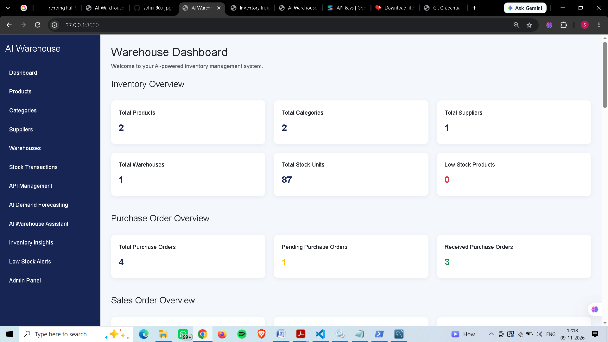
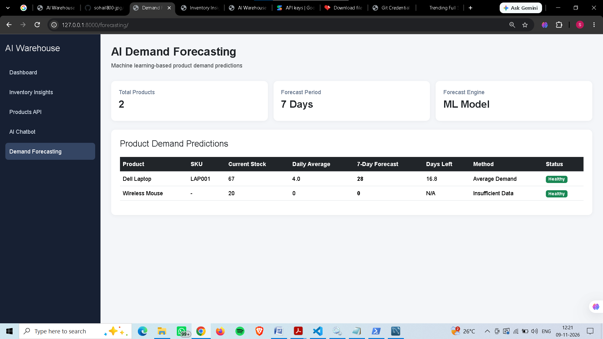
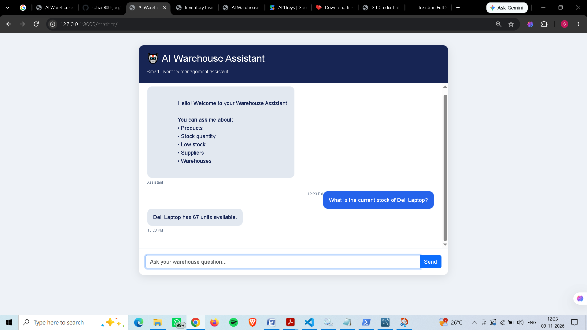
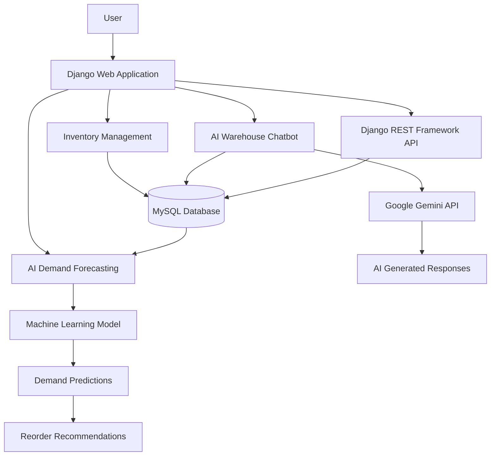

# AI-Powered Smart Warehouse Management System

An intelligent warehouse management application built using Django, Python, MySQL, Machine Learning, and Google Gemini AI.

## Features

- Warehouse dashboard and inventory management
- Product and category management
- Supplier and warehouse management
- Stock transactions and adjustments
- Purchase order management
- Sales order management
- Machine Learning demand forecasting
- Automatic reorder recommendations
- AI-powered warehouse chatbot
- Inventory insights and low-stock alerts
- REST API using Django REST Framework

## Technologies Used

- Python
- Django
- Django REST Framework
- MySQL
- Pandas
- NumPy
- Scikit-learn
- Google Gemini API
- HTML and CSS

## Installation

1. Clone the repository.
2. Create and activate a virtual environment.
3. Install dependencies using `pip install -r requirements.txt`.
4. Configure your `.env` file with database credentials and API keys.
5. Run migrations using `python manage.py migrate`.
6. Start the server using `python manage.py runserver`.

## Environment Variables

Configure these variables in your local `.env` file:

- DJANGO_SECRET_KEY
- DB_NAME
- DB_USER
- DB_PASSWORD
- DB_HOST
- DB_PORT
- GEMINI_API_KEY

## Project Status

Core warehouse management, forecasting, REST API, and AI chatbot features implemented.

## Screenshots

### 1. Warehouse Dashboard

### 2. AI Demand Forecasting

### 3. AI Warehouse Chatbot

    
## System Architecture

